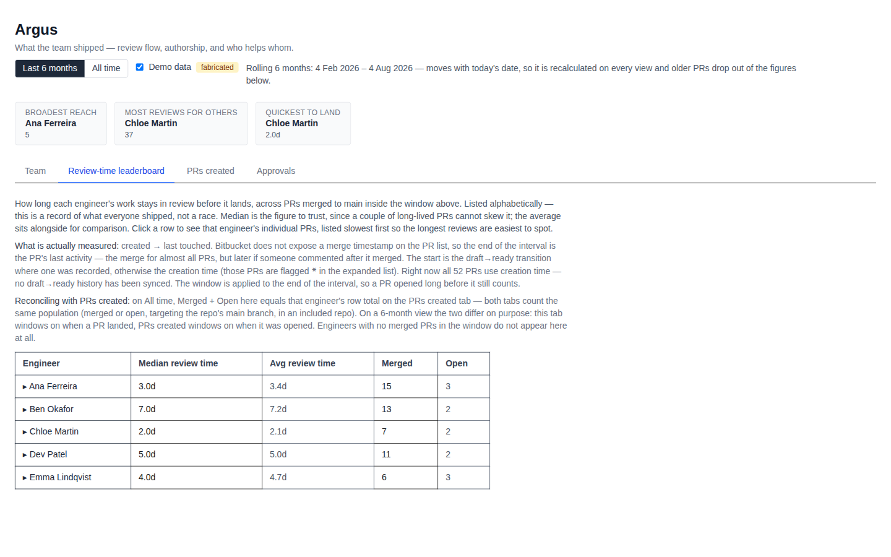
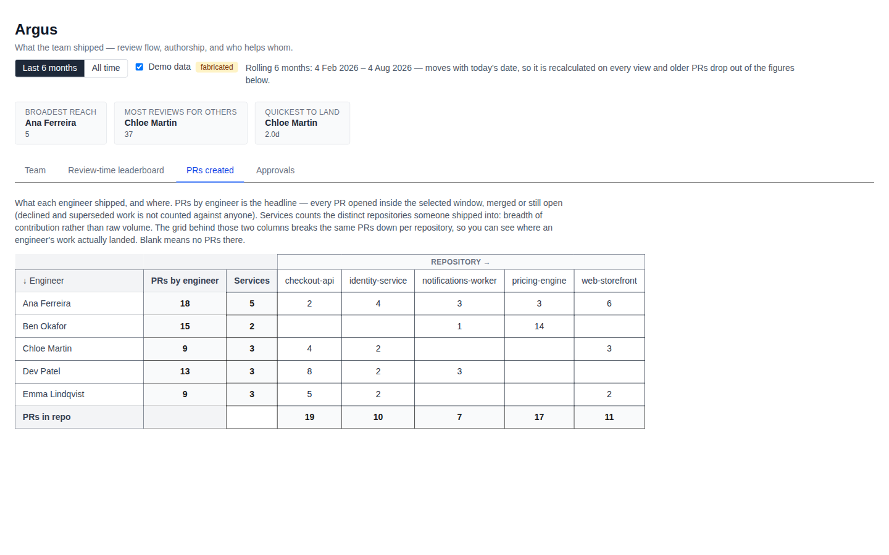
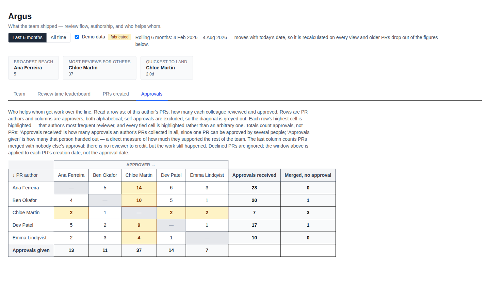

# Argus — PR Review Dashboard

**[Live demo → argus-blush-chi.vercel.app](https://argus-blush-chi.vercel.app/)**

A local Next.js dashboard that pulls pull-request data for a team and presents four analytical views: a team roster, a review-time leaderboard, a PRs-created matrix, and an approval matrix. GitHub is fetched live; Bitbucket is a frozen, read-only archive whose cached history still counts in every view. People and repos that exist on both providers are linked into one canonical entry with one continuous history. All data is cached in a local SQLite database so subsequent refreshes are incremental.

The live link above runs with no provider configured, so it serves [demo mode](#demo-mode): a seeded fixture of five invented engineers across five invented repositories. Every figure on it is fabricated — no real people, repositories or review times. The analytics computing those figures are the same ones that run against real data.

## Screenshots

All taken from the live demo.

### Review-time leaderboard

How long each engineer's work sits in review before it lands. Listed alphabetically rather than ranked by speed — the median and average are there to read, not to compete over. Rows expand to the individual PRs behind them.



### PRs created

What each engineer shipped and where. The headline PR count sits immediately beside the name, followed by Services — the number of distinct repositories they shipped into, a measure of breadth rather than volume. The grid behind those two columns breaks the same PRs down per repository.



### Approvals

Who helps whom get work over the line. Read a row as: of this author's PRs, how many each colleague reviewed. Self-approvals are excluded so the diagonal is greyed out, and each row's most frequent reviewer is highlighted. The final column counts PRs merged with nobody else's approval — work that happened but has no reviewer to credit.



## Stack

- **Next.js 16** (App Router) + **TypeScript**
- **Tailwind CSS v4** for styling
- **better-sqlite3** for local SQLite cache (`data/argus.sqlite`)
- **GitHub** (token) — fetched live
- **Bitbucket REST API v2** — frozen archive, never fetched again

## The four tabs

| Tab | What it shows |
|-----|---------------|
| **Team** | Team roster with per-user and per-repo include/exclude toggles; Discover workspace, Refresh data and Backfill all history controls |
| **Review-time leaderboard** | Median and average in-review duration per engineer, listed alphabetically; expandable rows show individual PRs, slowest first |
| **PRs created** | Matrix of PRs created — engineers (rows) × projects/repos (columns) — over the active window, with row/column totals and a Services count; repos with no in-scope PRs are omitted |
| **Approvals** | Matrix of approvals — PR authors (rows) × approvers (columns) — over the active window: how many of each author's PRs each colleague approved; self-approvals are excluded, and merged PRs nobody approved get their own column |

## Metric definitions

- **In-review time** is decided per PR. On GitHub it is **created → merged** (or ready → merged), both exact,
  from `merged_at` and the `ready_for_review` timeline event. On archived Bitbucket PRs it is **created → last
  touched**: Bitbucket's PR list exposes no merge timestamp, so the end is `updated_on` (the merge for almost
  all PRs, but later if anyone comments afterwards) and the start is creation time. Rows using a fallback
  start are flagged `*` in the leaderboard, and its caveat text is derived from the rows on screen. All
  migrated Bitbucket PRs were cached by fast syncs, so today every row is flagged; the asterisk becomes the
  exception once a deep GitHub backfill has run.
- **Scope**: `MERGED` or `OPEN` PRs targeting the repo's main branch, in an included repo, by an included user.
  `DECLINED`/`SUPERSEDED` are excluded as abandoned work. Defined once in `src/lib/analytics/scope.ts` so the
  tabs cannot disagree about which PRs exist.
- **Window**: rolling 6 months by default, rolling 30 days, or all time — switchable above the tabs and applied
  at read time, so the SQLite cache is never pruned.
- **Self-approvals**: excluded from the Approvals matrix.

## Setup

### 1. Create `.env.local`

```bash
cp .env.local.example .env.local
```

Open `.env.local` and fill in the required value (`GITHUB_TOKEN`):

| Variable | Description |
|----------|-------------|
| `GITHUB_TOKEN` | GitHub token able to read the organisation's repos, PRs and members |

Optional overrides (see `.env.local.example`):

- `GITHUB_ORG` — GitHub organisation to discover (default: `mvfglobal`)
- `ARGUS_DB_PATH` — override the SQLite cache location (default: `data/argus.sqlite`)
- `BITBUCKET_*` — not needed: Bitbucket is never fetched or discovered

### 2. Install dependencies

```bash
npm install
```

### 3. Start the development server

```bash
npm run dev
```

Open [http://localhost:3000](http://localhost:3000).

### 4. Discover your organisation

1. Go to the **Team** tab.
2. Click **Discover workspace** — Argus queries GitHub for the org's members and repos. Bitbucket is not
   queried: its repos and people were already migrated into the database. Repos and people with matching names
   (lower-cased, separators ignored) link to their Bitbucket counterparts automatically; anything else you can
   merge by hand, e.g. the renamed `benchmarkmeapp` → `benchmarkme`. GitHub members with private org
   membership are not discoverable; they appear later from PR authorship under their login, flagged as
   possible duplicates for you to merge.
3. Use the checkboxes to include or exclude specific people and repos.
4. Click **Refresh data** — Argus fetches PR activity for included GitHub repos and populates the SQLite cache.
   GitHub always syncs at full detail (its PR list has no review data), at two requests per PR.
   If a repository can't be read, the refresh finishes the rest and lists what it skipped, with the reason in
   plain English. A repository whose every copy is gone (404) gets a **Remove from roster** button beside it —
   deleted repos stay ticked otherwise, because Discover only ever adds.

After the first full refresh, subsequent refreshes are incremental. A repo's very first refresh only reaches
back 6 months, so the **All time** view is incomplete until you click **Backfill all history**.

**Argus will not spend your whole GitHub quota.** It uses the same token you do, so every refresh is bounded:
it stops while 1,000 requests are still free for your own use, spends at most 3,000 in any one run, and paces
what it sends. A refresh reports how much quota is left when it finishes, and refuses to start at all if the
allowance is already down to the reserve, telling you when it resets. Tune it with `GITHUB_RATE_LIMIT_RESERVE`,
`GITHUB_MAX_REQUESTS_PER_RUN` and `GITHUB_MIN_REQUEST_INTERVAL_MS`.

**The first backfill therefore takes several runs.** It costs roughly 6,000 GitHub requests. Each run stops
cleanly, keeps everything that completed, and says it stopped early; click Backfill again to carry on. This is
expected, not a fault. (One known limitation: a single repo whose full fetch exceeds one run's budget would
never complete, because a repo is saved only once it has been fully fetched. Not reachable at this data size.)

## Migrating an existing cache

Opening a database from before dual-provider support runs forward-only numbered migrations automatically. A
verified snapshot is written beside the cache first, and the migration is refused if it can't be; each step runs
in a transaction and rolls back if the PR or approval row counts change. The original tables are renamed to
`legacy_*`, never dropped. A database newer than the code refuses to open.

## Demo mode

No credentials? Argus still runs. With no provider configured (no `GITHUB_TOKEN`, no Bitbucket credentials), a **Demo data** toggle appears beside the date-range toggle, and it defaults to on — this is what lets the dashboard deploy publicly with nothing to configure. [argus-blush-chi.vercel.app](https://argus-blush-chi.vercel.app/) is exactly that: a Vercel deployment with no environment variables set.

- Demo mode swaps the data source for a seeded, in-memory fixture of 5 engineers and 5 repos — the same record types the database returns, run through the same analytics functions, so the demo can't drift from real behaviour.
- It never touches SQLite: nothing is read or written to `data/argus.sqlite`, which is what makes it safe on a read-only filesystem.
- Discover, Refresh data, and the roster checkboxes are all disabled while it's on, since there is no real workspace to modify.
- Dates in the fixture are generated relative to the current time, so every window setting — **Last 30 days**, **Last 6 months** and **All time** — always shows data.
- On a deployment with real credentials, the toggle never appears — demo mode is only ever available when there is nothing real to protect.

## Data persistence

All PR data is stored in `data/argus.sqlite` at the project root. The file is created automatically on first refresh and is excluded from version control (`.gitignore`). Delete it only if you mean to lose the Bitbucket history: the cache holds the only copy of it, and Bitbucket is never fetched again, so a deleted cache cannot be rebuilt for those PRs (GitHub data can be re-fetched).

## Environment variables reference

| Variable | Required | Default | Description |
|----------|----------|---------|-------------|
| `GITHUB_TOKEN` | Yes | — | GitHub token (repos, PRs, members) |
| `GITHUB_ORG` | No | `mvfglobal` | GitHub organisation to discover |
| `BITBUCKET_EMAIL` / `BITBUCKET_API_TOKEN` / `BITBUCKET_WORKSPACE` / `BITBUCKET_PROJECT_KEY` | No | — | Bitbucket is a read-only archive and is never fetched; these only count toward "a provider is configured" for demo mode |
| `ARGUS_DB_PATH` | No | `data/argus.sqlite` | Override SQLite cache path |
